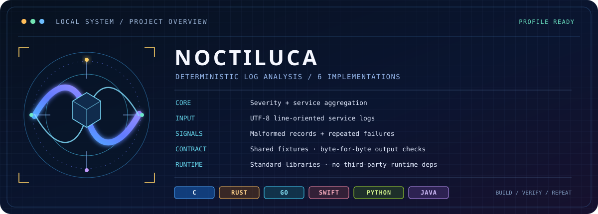

# NOCTILUCA

<p align="center">
  
</p>

<p align="center">
  <strong>A deterministic log scanner, implemented six ways.</strong><br>
  One input contract. Six standard-library implementations. Reproducible output.
</p>

<p align="center">
  <a href="https://github.com/BitResonance/noctiluca/actions/workflows/ci.yml"></a>
  
  
  <a href="LICENSE"></a>
</p>

NOCTILUCA reads plain-text service logs and produces a compact, stable report. It counts events by severity and service, identifies malformed records, and surfaces repeated `ERROR` or `FATAL` messages. All six implementations follow the same specification and are verified against shared golden fixtures.

## System profile

Want the neofetch-like project summary in your own terminal? Run:

```bash
python3 scripts/project_profile.py
```

The profile describes the project and detects available language toolchains. It does **not** print your username, hostname, current directory, absolute paths, or environment-variable values. Add `--no-color` for logs and CI.

Example:

```text
NOCTILUCA // SYSTEM PROFILE
────────────────────────────────────────────────────────────
PLATFORM         Linux 6.x · x86_64
RUNTIME          Python 3.12.x (profile utility)
PURPOSE          Deterministic service-log summarizer
LANGUAGES        C · Rust · Go · Swift · Python · Java
INPUT            UTF-8 line-oriented service logs
ANALYSIS         Severity counts · service totals · repeated failures
DEPENDENCIES     Standard library per implementation
NETWORK          Not used by the analyzer
TOOLCHAINS       C ✓  Rust ✓  Go ✓  Swift —  Python ✓  Java ✓
PRIVACY          No personal identity or local paths displayed
```

## What it does

- Counts valid events by severity and service.
- Skips malformed records while reporting their count.
- Groups repeated error messages by exact service/message pair.
- Keeps ordering and formatting deterministic for scripts and tests.
- Provides the same behavior in C, Rust, Go, Swift, Python, and Java.

## Example

```console
$ python3 python/noctiluca.py fixtures/sample.log
NOCTILUCA / REPORT
Events: 12
Malformed: 1

LEVEL COUNTS
DEBUG=1
INFO=3
WARN=2
ERROR=5
FATAL=1

SERVICE COUNTS
auth=5
api=4
gateway=1
storage=1
worker=1

REPEATED FAILURES (>=3)
auth | invalid token signature | 3
```

## Run it

Python is enough to try the project:

```bash
python3 python/noctiluca.py fixtures/sample.log
```

To verify every implementation whose toolchain is installed:

```bash
python3 scripts/verify_outputs.py
```

Run only the terminal profile's unit tests:

```bash
python3 -m unittest discover -s scripts -p 'test_*.py'
```

The verifier skips languages whose toolchain is missing. GitHub Actions installs the toolchains in separate jobs and checks the same fixtures. The profile utility itself uses Python's standard library only.

## Implementations

| Language | Command |
|---|---|
| C | `make -C c && ./c/noctiluca fixtures/sample.log` |
| Rust | `cargo run --manifest-path rust/Cargo.toml -- fixtures/sample.log` |
| Go | `cd go && go run ./cmd/noctiluca ../fixtures/sample.log` |
| Swift | `swift run --package-path swift Noctiluca fixtures/sample.log` |
| Python | `python3 python/noctiluca.py fixtures/sample.log` |
| Java | `javac -d java/out java/src/main/java/dev/noctiluca/Main.java && java -cp java/out dev.noctiluca.Main fixtures/sample.log` |

Each implementation uses its language's standard library. The input format and output rules are documented in [`spec/LOG_FORMAT.md`](spec/LOG_FORMAT.md).

## Project layout

```text
c/         C implementation
rust/      Rust implementation
go/        Go implementation
swift/     Swift implementation
python/    Python implementation
java/      Java implementation
fixtures/  shared inputs and expected reports
scripts/   cross-language verifier and terminal profile
spec/      log format and output contract
docs/      system-profile artwork
```

## Current limits

Timestamps are checked for the expected UTC shape, but not for real calendar dates. The scanner does not correlate events across time windows or infer root causes; repeated failures are counted by exact service/message pair.

## Contributing

See [`CONTRIBUTING.md`](CONTRIBUTING.md). Changes to parsing or report output should update the specification and shared fixtures before changing the implementations.

## License

MIT. See [`LICENSE`](LICENSE).
